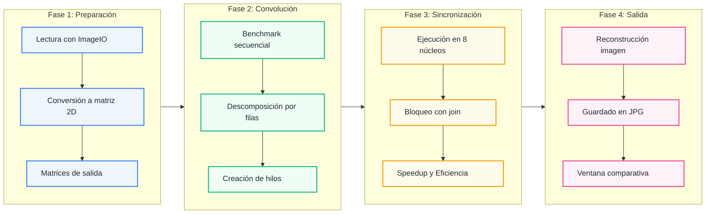

# Procesamiento de Imágenes Multihilo: Convolución 9x9 (Java Threads)


## RESUMEN (ABSTRACT)

**Problema:** Aplicar filtros de convolución de gran tamaño sobre imágenes de alta resolución es una tarea computacionalmente costosa. Procesar los píxeles de forma secuencial deja ociosos a la mayoría de los núcleos del procesador y genera tiempos de espera elevados.

**Propuesta:** Se implementa un filtro de convolución **9x9** (suavizado + realce de bordes con operadores tipo Sobel ampliados) sobre una imagen de **7728 x 5152 píxeles**. La concurrencia se gestiona a bajo nivel con la clase nativa `Thread`, sin `ExecutorService` ni `parallelStream`. El dominio (las filas de la imagen) se descompone en bloques contiguos, uno por hilo, sobre memoria compartida y sin necesidad de bloqueos.

**Tecnologías:** Java 27 (`BufferedImage`, `ImageIO`, Swing), concurrencia nativa con `Thread` y automatización por `Makefile` / `make.bat`.

**Resultados:** El procesamiento de **~39.7 millones de píxeles** se redujo de **11.77 s** (secuencial) a **2.02 s** con 8 hilos, logrando una aceleración de **5.83x** y una eficiencia del **72.9%**.

---

## ARQUITECTURA DEL SISTEMA

El diseño sigue la metodología de diseño de algoritmos paralelos (descomposición, comunicación, aglomeración y mapeo). Cada hilo escribe únicamente en su propio rango de filas de la matriz de salida y solo lee de la matriz de entrada, por lo que **no existen *Race Conditions*** ni se requiere sincronización durante el cálculo.



### Descomposición del dominio

Los píxeles del borde (4 píxeles por lado, el radio del kernel) no se procesan, ya que la vecindad 9x9 quedaría fuera de la imagen. Las filas restantes se reparten en bloques equitativos:

| Parámetro | Valor |
|---|---|
| Filas procesables (`alto - 2 * radio`) | 5,144 |
| Hilos (p) | 8 (núcleos físicos del procesador) |
| Filas por hilo | 643 (división exacta, carga balanceada) |
| Píxeles procesados | ~39.7 millones |
| Operaciones de vecindad (píxeles × 81) | ~3,200 millones |

El último hilo absorbe cualquier fila sobrante en caso de que la división no sea exacta.

### El filtro

Por cada píxel se recorre su vecindad de 9x9 y se calculan, para cada canal (R, G, B):

1. **Suavizado:** promedio simple de los 81 vecinos.
2. **Detección de bordes:** gradientes horizontal (`Gx`) y vertical (`Gy`) con dos kernels 9x9 ponderados, combinados como magnitud `√(Gx² + Gy²)`.
3. **Mezcla final:** `base × 0.85 + borde × 1.8` (R y G) y `base × 0.95 + borde × 2.1` (B), con límite al rango 0-255. El resultado es un realce de bordes con un tono ligeramente azulado ("realce nocturno").

Optimizaciones aplicadas: aritmética de enteros puros en el bucle interno y referencias directas a filas (`int[]`) para reducir saltos en memoria.

---

## Análisis de Rendimiento y Resultados

Se procesó una fotografía de paisaje de **7728 x 5152 píxeles** con el mismo código para ambos modos, y se midió el tiempo de la fase de convolución. Se calcularon las métricas clásicas de rendimiento paralelo:

- **Speedup:** `S = Ts / Tp`
- **Eficiencia:** `E = S / p`

| Método de Procesamiento | Hilos | Tiempo (ms) | Tiempo (s) | Aceleración (Speedup) | Eficiencia |
|---|---|---|---|---|---|
| Secuencial (Baseline) | 1 | 11,773.00 ms | 11.77 s | 1.00x | 100% |
| Paralelo (núcleos físicos) | 8 | 2,020.00 ms | 2.02 s | 5.83x | 72.9% |

### ¿Por qué 8 hilos y no 16?

El procesador cuenta con **8 núcleos físicos y 16 hilos lógicos**. Se probó también con los 16 hilos lógicos: el tiempo paralelo fue de apenas **1.64 s** (unos 0.4 s menos que con 8 hilos), pero la eficiencia cayó a **~39%**. Los hilos lógicos adicionales comparten las unidades de ejecución y la caché de los núcleos físicos, por lo que duplicar los hilos no duplica el rendimiento. Se eligió **8 hilos (uno por núcleo físico)** por ser el mejor balance entre tiempo y uso de recursos.

### Interpretación

- El paralelismo redujo el tiempo de procesamiento en **~83%** (de 11.77 s a 2.02 s).
- La eficiencia del 72.9% queda por debajo del ideal (100%) por factores habituales: el ancho de banda de memoria es compartido entre núcleos y existe el costo de creación y sincronización de hilos.
- Al ser la primera fase en ejecutarse, el modo secuencial incluye el calentamiento del compilador JIT de la JVM, lo que puede inflar ligeramente su tiempo respecto al paralelo.
- La carga y la copia de la imagen a matriz, así como el guardado final, son partes secuenciales que no se miden en Ts ni Tp.

---

## Compilación y Ejecución

El proyecto incluye un `Makefile` (Linux/macOS) y un `make.bat` (Windows) para abstraer la compilación manual de Java y la limpieza de binarios.

```bash
# 1. Clonar el repositorio
git clone https://github.com/elsebasdev1/image_convolution_parallel_processing
cd image_convolution_parallel_processing

# 2. Compilar el código y ejecutar las pruebas
make                # Linux / macOS
.\make              # Windows

# 3. Limpiar binarios
make clean          # Linux / macOS
.\make clean        # Windows
```

Al finalizar, el programa guarda la imagen filtrada en `resources/paisaje_filtrado.jpg` y abre una ventana que muestra la imagen original junto a la procesada, con las métricas de tiempo, speedup y eficiencia.

> El número de hilos está fijado en `App.java` (`numHilos = 8`, igual a los núcleos físicos). Para usar todos los hilos lógicos del equipo, se puede descomentar la línea `Runtime.getRuntime().availableProcessors()`.

---

## 📂 Estructura del Repositorio

```
├── resources/
│   ├── paisaje.jpg             # Imagen de entrada (7728 x 5152 px)
│   └── paisaje_filtrado.jpg    # Imagen de salida generada
├── src/
│   ├── App.java                # Orquestador: carga, benchmark, particionamiento y métricas
│   ├── FiltroKernel.java       # Kernels 9x9 y lógica de convolución (compartida por ambos modos)
│   ├── HiloConvolucion.java    # Definición del Obrero (extends Thread)
│   └── VentanaComparacion.java # Interfaz Swing con la comparación visual y las métricas
├── Makefile                    # Automatización de compilación (Linux/macOS)
└── make.bat                    # Automatización de compilación (Windows)
```
